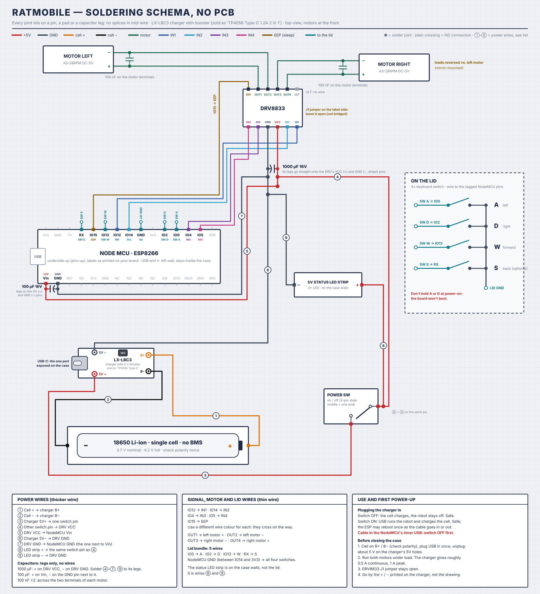

# ratmobile

## Files

- `ratmobile-final.svg` — soldering schema (no PCB)
- `ratmobile_home.ino` — **latest firmware** (joins your home WiFi, falls back to its own hotspot; set `WIFI_SSID` / `WIFI_PASS` first)
- `ratmobile.ino` — ESP8266 firmware, hotspot-only version (Arduino project file; NodeMCU 1.0 / ESP-12E)

## Status

Placeholder — wiring notes and build instructions will be added here.
