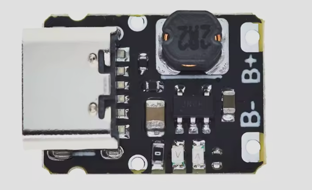

# ratmobile

## Files

- `ratmobile-final.svg` — soldering schema (no PCB)
- `ratmobile_home.ino` — ESP8266 firmware (Arduino project file; NodeMCU 1.0 / ESP-12E) — joins home WiFi, falls back to its own hotspot; set `WIFI_SSID` / `WIFI_PASS` first

## Components

1x [ESP8266 serial port wifi module NodeMCU Lua V3 Internet of Things development board TYPE-C interface CH340](https://www.aliexpress.com/item/1005006889833004.html)

1x [DRV8833 2 Channel DC Motor Driver Module Board 1.5A 3V-10V H-Bridge 4-Wire Step Motor Overcurrent Protection Step Motor Drive](https://www.aliexpress.com/item/1005006370873675.html)

1x **important** — [USB-C 1.2A 2 In 1 Type-C USB TP4056 1A Lithium Battery Charging Protection Board Module Polymer Battery With Temperature Protection](https://www.aliexpress.com/item/1005004981377952.html) — LX-LBC3 board with 5V booster (the booster is an R2R). This is the power board: it boosts the 3.7 V battery up to 5 V **and** charges the battery at the same time.

2x [A3-28RPM Micro Mini N20 Gear Motor DC 5V Slow Speed Full Metal Gearbox Reducer Electric Motor DIY Toy](https://www.aliexpress.com/item/1005008129258889.html)

1x Back Wheel [Nylon, CY-25D Screw Universal Ball Transfer Caster Nylon Ball Transfer Conveyor Roller Wheel](https://www.aliexpress.com/item/1005008484115118.html)

2x [KCD1-110 Red Super Thin Rocker Switch NO/OFF](https://www.aliexpress.com/item/1005010653861985.html)

3x (min) [MMD Princess V5 Ultra Switch Linear Tactile 5Pin 38g](https://www.aliexpress.com/item/1005010534245975.html)

Any white 5 V cuttable LED strip — for the status lights in front and back. Just cut it, solder to wires, glue to the case. (No specific listing — any 5 V cuttable white strip works.)

2x M3 screws (8 mm length) + 2x M3 heat inserts — needed for the keyboard fixture: heat inserts go into the case, screws (8 mm M3) attach the keyboard through them.

### Capacitors (from the schema — legs only, no wires)

- **2x 100 nF ceramic** — the two small beige disc capacitors; soldered across the two terminals of each motor (suppresses motor noise).
- **1x 100 µF 16 V** — the small electrolytic cylinder (polarity stripe on the side): `+` on Vin, `−` on the GND pin next to it.
- **1x 1000 µF 16 V** — the larger electrolytic cylinder: `+` on DRV VCC, `−` on DRV GND.
